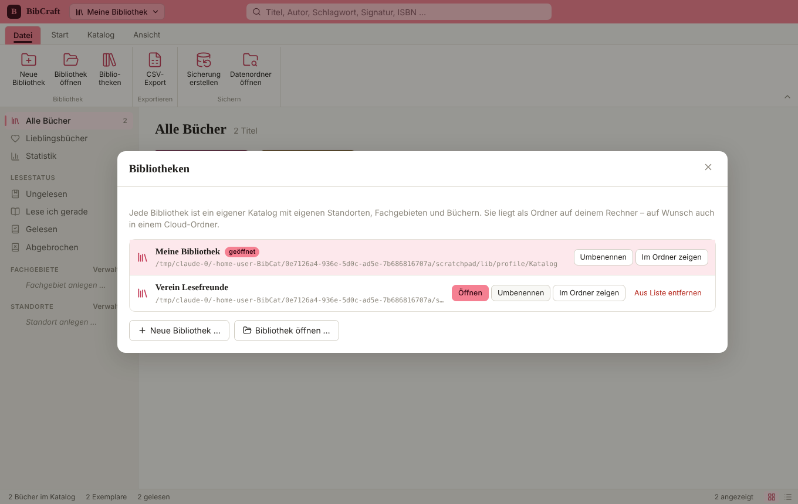
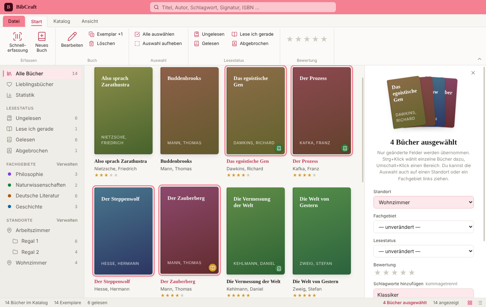
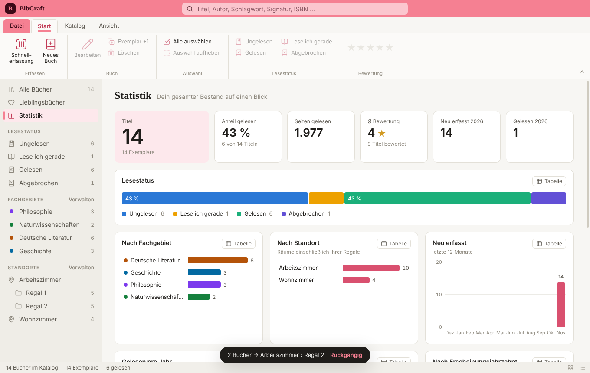

# BibCraft

Desktop-Programm zur Katalogisierung privater Bibliotheksbestände – für Windows und macOS,
auf Deutsch und Englisch.

Schlank in der Bedienung, aber mit bibliothekarischer Tiefe: Signatur, Auflage, Reihe, Fachgebiete
mit Systematik-Notation, Schlagworte, Exemplare und verschachtelte Standorte.


## Funktionen

- **Menüband wie in Office** mit den Registerkarten Datei, Start, Katalog und Ansicht.
  Doppelklick auf eine Registerkarte oder `Strg+F1` klappt es ein und aus.
- **Schnellerfassung**: ISBN scannen oder eintippen – die Daten werden abgerufen und das Buch sofort
  mit voreingestelltem Standort, Fachgebiet und Lesestatus gespeichert. Duplikate werden erkannt
  (dann „+ Exemplar"), jede Erfassung lässt sich rückgängig machen.
- **Barcode-Scan per Kamera** (EAN-13, nur Buch-ISBNs 978/979). USB-Handscanner funktionieren
  ohne Einrichtung, da sie wie eine Tastatur tippen.
- **ISBN-Abfrage** bei der Deutschen Nationalbibliothek (MARC21, inkl. GND-Schlagworte),
  Open Library und Google Books; Treffer werden zusammengeführt, Cover lokal gespeichert.
- **Standorte** als Baum (Raum › Regal › Fach); ein Raum zeigt auch alle Bücher seiner Regale.
- **Fachgebiete** mit Farbe und optionaler Notation (z. B. DDC).
- **Bewertung** (0–5 Sterne) und **Lesestatus** (ungelesen, lese gerade, gelesen, abgebrochen).
- **Volltextsuche** in der Titelleiste über Titel, Autoren, Schlagworte, Signatur, ISBN, Notizen.
- **Sprachen**: Deutsch und Englisch, umschaltbar unter *Ansicht › Sprache*. Beim ersten Start
  richtet sich die Sprache nach dem Betriebssystem.
- Raster- und Listenansicht, ein- und ausblendbare Bereiche, Hell-/Dunkelmodus nach System.
- **Mehrere Bibliotheken**: jede ein eigener Katalog mit eigenen Standorten, Fachgebieten und
  Büchern, z. B. privat, Verein und Ferienhaus. Umschalten über den Bibliotheksnamen in der
  Titelleiste; anlegen, öffnen, umbenennen und verwalten unter *Datei › Bibliothek*. Eine
  Bibliothek ist ein normaler Ordner und kann an einem beliebigen Ort liegen.
- **Massenbearbeitung**: mehrere Bücher markieren (Strg+Klick, Umschalt+Klick, Strg+A) und
  gemeinsam Standort, Fachgebiet, Lesestatus, Bewertung oder Schlagworte ändern – oder die Auswahl
  einfach auf einen Standort, ein Fachgebiet oder einen Lesestatus im Navigationsbereich ziehen.
  Jede Sammeländerung und jedes Löschen lässt sich rückgängig machen.
- **Statistik**: Kennzahlen und Diagramme zu Lesestatus, Fachgebieten, Standorten, Neuzugängen,
  gelesenen Büchern pro Jahr, Erscheinungsjahrzehnten, Autoren, Sprachen und Bewertungen; jedes
  Diagramm auch als Tabelle. Ein Klick auf einen Balken zeigt die zugehörigen Bücher.
- **CSV-Export** (Excel-kompatibel, Spalten in der gewählten Sprache) und **Sicherung**.

Tastenkürzel: `Strg/⌘ + N` neues Buch, `Strg/⌘ + F` Suche, `Strg/⌘ + A` alle auswählen,
`Entf` Auswahl löschen, `Strg/⌘ + F1` Menüband, `Esc` Auswahl aufheben bzw. Dialog schließen.



| Massenbearbeitung | Statistik |
|---|---|
|  |  |
| **Englisch** | **Dunkelmodus, Menüband eingeklappt** |
|  |  |

## Daten

Jede Bibliothek ist ein Ordner mit einer SQLite-Datenbank (`katalog.sqlite`) und den Covern als
Bilddateien im Unterordner `covers`. Die erste Bibliothek und die Programmeinstellungen liegen hier:

| System  | Erste Bibliothek | Weitere Bibliotheken (Standard) | Einstellungen |
|---------|------------------|---------------------------------|---------------|
| Windows | `%APPDATA%\BibCraft\Katalog\` | `%APPDATA%\BibCraft\Bibliotheken\` | `%APPDATA%\BibCraft\profile.json` |
| macOS   | `~/Library/Application Support/BibCraft/Katalog/` | `…/BibCraft/Bibliotheken/` | `…/BibCraft/profile.json` |

`profile.json` enthält die Liste der Bibliotheken, die zuletzt geöffnete und die Sprache.
Mit den Umgebungsvariablen `BIBCRAFT_DATA_DIR` (Bibliothek) und `BIBCRAFT_PROFILE_DIR`
(Einstellungen) lassen sich andere Orte verwenden, z. B. für eine portable Installation.

**Umstieg von BibCat:** Bis Version 0.1 hieß das Programm BibCat. BibCraft übernimmt einen
vorhandenen BibCat-Katalog beim ersten Start automatisch (Kopie; das Original unter
`…\BibCat\Katalog` bleibt unverändert erhalten). Der neue Installer ersetzt die alte Installation.

## Technik

- Electron 45 + React 19 + TypeScript, gebaut mit electron-vite
- SQLite über das in Electron eingebaute `node:sqlite` mit FTS5-Volltextindex –
  keine nativen Module, dadurch unkomplizierte Builds für alle Plattformen
- Barcode-Erkennung mit ZXing (läuft lokal), Symbole von Lucide
- Übersetzungen in `src/shared/i18n.ts`; TypeScript stellt sicher, dass jeder Text in allen
  Sprachen vorhanden ist. Eine weitere Sprache = ein weiteres Wörterbuch dort.

## Entwicklung

Voraussetzung: Node.js 22 oder neuer.

```bash
npm install
npm run dev        # App mit Hot-Reload starten
npm test           # Tests
npm run typecheck
```

## Herunterladen und Updates

Fertige Installer gibt es unter **[Releases](https://github.com/Jordinchen/BibCat/releases)**.
Installiertes BibCraft sucht beim Start selbst nach neuen Versionen (abschaltbar unter
*Datei › Über BibCraft*); unter Windows wird das Update geladen und mit einem Klick installiert.
Was sich geändert hat, steht in [`CHANGELOG.md`](CHANGELOG.md).

**Hinweis zur Signierung:** Die Installer sind derzeit unsigniert. Windows zeigt beim ersten Start
eine SmartScreen-Warnung („Weitere Informationen" → „Trotzdem ausführen"); unter macOS die App beim
ersten Mal per Rechtsklick → „Öffnen" starten. Unter macOS installieren sich Updates erst mit
Signierung automatisch, bis dahin weist BibCraft auf neue Versionen hin.

## Neue Version veröffentlichen

1. Version in `package.json` erhöhen und einen Abschnitt in `CHANGELOG.md` ergänzen.
2. Commit pushen und eine Versionsmarke setzen, z. B. `git tag v0.5.1 && git push origin v0.5.1`.
3. Der Workflow `.github/workflows/build.yml` baut Windows und macOS und veröffentlicht ein
   Release mit den Installern, den Update-Beschreibungen (`latest*.yml`) und der Änderungsliste.

Lokal bauen (auf dem jeweiligen Betriebssystem):

```bash
npm run dist:win   # erzeugt dist/BibCraft-Setup-x.y.z.exe
npm run dist:mac   # erzeugt dist/BibCraft-x.y.z-universal.dmg
```

## Projektstruktur

```
src/main/        Electron-Hauptprozess: Datenbank (db.ts), ISBN-Abfrage (lookup.ts), CSV
src/preload/     Sichere Brücke zwischen Oberfläche und Hauptprozess
src/renderer/    React-Oberfläche (Menüband: components/Ribbon.tsx)
src/shared/      Gemeinsame Typen, Übersetzungen, ISBN-Hilfsfunktionen
tests/           Vitest-Tests
```

## Lizenz

BibCraft ist freie Software unter der **GNU General Public License, Version 3 oder (nach deiner
Wahl) jeder späteren Version** (`GPL-3.0-or-later`). Den vollständigen Text enthält die Datei
[`LICENSE`](LICENSE); im Programm steht er unter *Datei › Über BibCraft*.

    BibCraft – Katalogisierung privater Bibliotheken
    Copyright (C) 2026 David Rosa

    This program is free software: you can redistribute it and/or modify
    it under the terms of the GNU General Public License as published by
    the Free Software Foundation, either version 3 of the License, or
    (at your option) any later version.

    This program is distributed in the hope that it will be useful,
    but WITHOUT ANY WARRANTY; without even the implied warranty of
    MERCHANTABILITY or FITNESS FOR A PARTICULAR PURPOSE.  See the
    GNU General Public License for more details.

    You should have received a copy of the GNU General Public License
    along with this program.  If not, see <https://www.gnu.org/licenses/>.

BibCraft verwendet freie Bibliotheken unter MIT-, Apache-2.0- und ISC-Lizenz. Ihre Lizenztexte
werden beim Build von `scripts/third-party-licenses.mjs` gesammelt und unter *Über BibCraft*
angezeigt.
