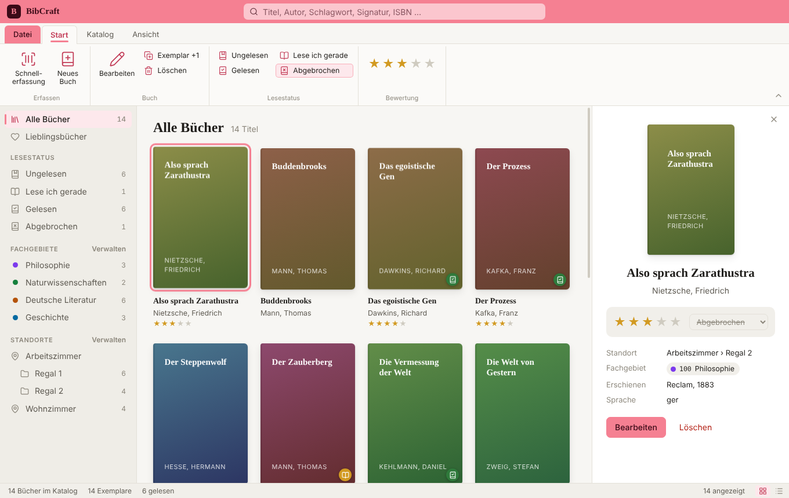
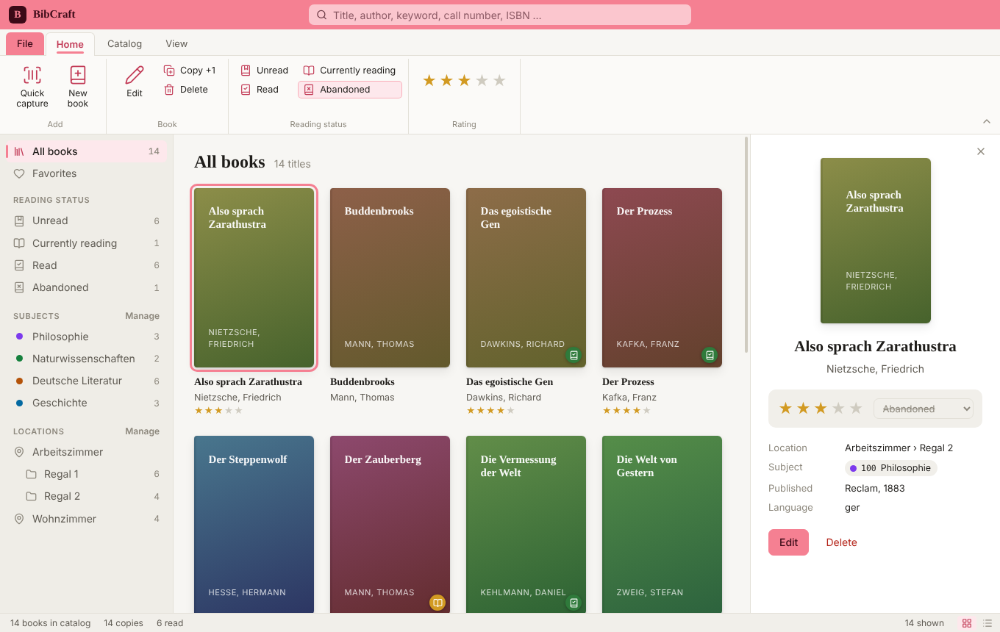
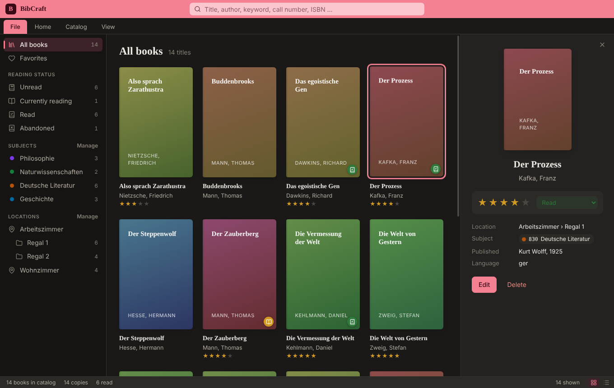

# BibCraft

Desktop-Programm zur Katalogisierung privater Bibliotheksbestände – für Windows und macOS,
auf Deutsch und Englisch.

Schlank in der Bedienung, aber mit bibliothekarischer Tiefe: Signatur, Auflage, Reihe, Fachgebiete
mit Systematik-Notation, Schlagworte, Exemplare und verschachtelte Standorte.



## Funktionen

- **Menüband wie in Office** mit den Registerkarten Datei, Start, Katalog und Ansicht.
  Doppelklick auf eine Registerkarte oder `Strg+F1` klappt es ein und aus.
- **Schnellerfassung**: ISBN scannen oder eintippen – die Daten werden abgerufen und das Buch sofort
  mit voreingestelltem Standort, Fachgebiet und Lesestatus gespeichert. Duplikate werden erkannt
  (dann „+ Exemplar"), jede Erfassung lässt sich rückgängig machen.
- **Barcode-Scan per Kamera** (EAN-13, nur Buch-ISBNs 978/979). USB-Handscanner funktionieren
  ohne Einrichtung, da sie wie eine Tastatur tippen.
- **ISBN-Abfrage** bei der Deutschen Nationalbibliothek (MARC21, inkl. GND-Schlagworte),
  Open Library und Google Books; Treffer werden zusammengeführt, Cover lokal gespeichert.
- **Standorte** als Baum (Raum › Regal › Fach); ein Raum zeigt auch alle Bücher seiner Regale.
- **Fachgebiete** mit Farbe und optionaler Notation (z. B. DDC).
- **Bewertung** (0–5 Sterne) und **Lesestatus** (ungelesen, lese gerade, gelesen, abgebrochen).
- **Volltextsuche** in der Titelleiste über Titel, Autoren, Schlagworte, Signatur, ISBN, Notizen.
- **Sprachen**: Deutsch und Englisch, umschaltbar unter *Ansicht › Sprache*. Beim ersten Start
  richtet sich die Sprache nach dem Betriebssystem.
- Raster- und Listenansicht, ein- und ausblendbare Bereiche, Hell-/Dunkelmodus nach System.
- **CSV-Export** (Excel-kompatibel, Spalten in der gewählten Sprache) und **Sicherung**.

Tastenkürzel: `Strg/⌘ + N` neues Buch, `Strg/⌘ + F` Suche, `Strg/⌘ + F1` Menüband, `Esc` schließt Dialoge.

| Englisch | Dunkelmodus, Menüband eingeklappt |
|---|---|
|  |  |

## Daten

Der Katalog ist eine SQLite-Datenbank (`katalog.sqlite`), die Cover liegen als Bilddateien daneben:

| System  | Ort |
|---------|-----|
| Windows | `%APPDATA%\BibCraft\Katalog\` |
| macOS   | `~/Library/Application Support/BibCraft/Katalog/` |

Mit der Umgebungsvariable `BIBCRAFT_DATA_DIR` lässt sich ein anderer Ordner verwenden.

**Umstieg von BibCat:** Bis Version 0.1 hieß das Programm BibCat. BibCraft übernimmt einen
vorhandenen BibCat-Katalog beim ersten Start automatisch (Kopie; das Original unter
`…\BibCat\Katalog` bleibt unverändert erhalten). Der neue Installer ersetzt die alte Installation.

## Technik

- Electron 45 + React 19 + TypeScript, gebaut mit electron-vite
- SQLite über das in Electron eingebaute `node:sqlite` mit FTS5-Volltextindex –
  keine nativen Module, dadurch unkomplizierte Builds für alle Plattformen
- Barcode-Erkennung mit ZXing (läuft lokal), Symbole von Lucide
- Übersetzungen in `src/shared/i18n.ts`; TypeScript stellt sicher, dass jeder Text in allen
  Sprachen vorhanden ist. Eine weitere Sprache = ein weiteres Wörterbuch dort.

## Entwicklung

Voraussetzung: Node.js 22 oder neuer.

```bash
npm install
npm run dev        # App mit Hot-Reload starten
npm test           # Tests
npm run typecheck
```

## Installer bauen

Auf dem jeweiligen Betriebssystem:

```bash
npm run dist:win   # erzeugt dist/BibCraft Setup x.y.z.exe
npm run dist:mac   # erzeugt dist/BibCraft-x.y.z-universal.dmg
```

Alternativ baut der GitHub-Actions-Workflow (`.github/workflows/build.yml`) bei jedem Push beide
Installer; sie liegen dann als Artefakte am Workflow-Lauf.

**Hinweis zur Signierung:** Die Installer sind unsigniert. Windows zeigt beim ersten Start eine
SmartScreen-Warnung („Weitere Informationen" → „Trotzdem ausführen"); unter macOS die App beim
ersten Mal per Rechtsklick → „Öffnen" starten.

## Projektstruktur

```
src/main/        Electron-Hauptprozess: Datenbank (db.ts), ISBN-Abfrage (lookup.ts), CSV
src/preload/     Sichere Brücke zwischen Oberfläche und Hauptprozess
src/renderer/    React-Oberfläche (Menüband: components/Ribbon.tsx)
src/shared/      Gemeinsame Typen, Übersetzungen, ISBN-Hilfsfunktionen
tests/           Vitest-Tests
```
